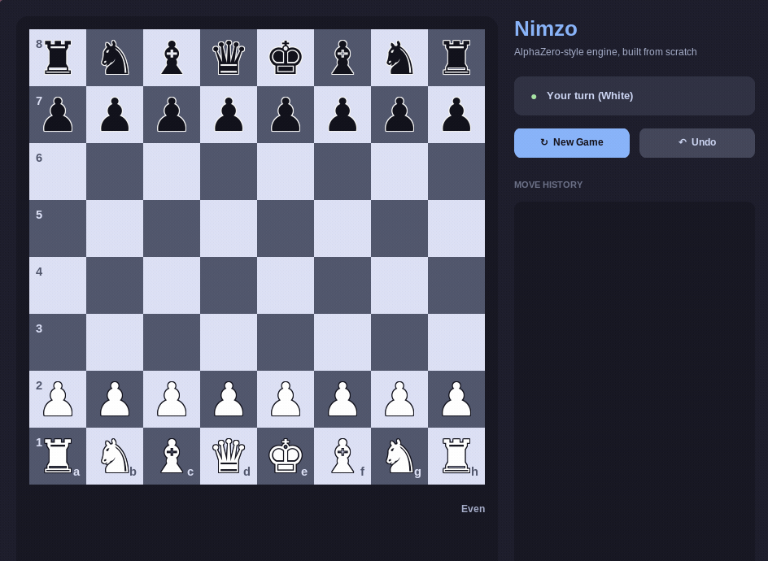

# Nimzo - A Chess Engine Built From Scratch

A chess engine built from the ground up: board/move encoding, a binary training-data
pipeline, an AlphaZero-style ResNet + PUCT Monte Carlo Tree Search, a UCI interface,
a terminal client, and a desktop GUI. No existing chess engine code, no pretrained
weights — the policy/value network is distilled from scratch on Lichess puzzle data
and Stockfish evaluations.

Currently, the engine plays at roughly an **800–1000 Elo** level (equivalent to an intermediate beginner/casual human player), demonstrating basic tactical awareness, piece development, and endgame mechanics.

<p align="center">
  
</p>

## Training

The current model is trained on a mix of Lichess puzzle positions (tactical, one-hot
best-move labels) and real Stockfish-evaluated positions (positional, varying
centipawn scores) — puzzles alone give a sharp tactical policy but almost no usable
value signal (every puzzle carries the same fixed win-probability label), so combining
both is what makes the value head actually distinguish winning from losing positions.
The two sources are mixed via a fixed sampling ratio rather than a plain concatenation
(`RatioSampler` in `nimzo/data/shards.py`), since naively concatenating lets the
larger source drown out the smaller one regardless of how the split was intended.

Training uses a cosine LR schedule with warmup. It initial version runed on my personal laptop (8GB RAM and no GPU) it took more than 6 hours to finish but this version runs on a free Kaggle T4 GPU to save time (see
`notebooks/train.ipynb`) — CPU-only local training is also supported
(`scripts/train.sh`) for smaller runs.

Training is ongoing — current model checkpoints play around 800–1000 Elo and are being refined further with larger datasets and deeper MCTS search. Match records from evaluation runs are in `results/*.pgn`.

## Quick Start

### 1. Environment & Tests

```bash
source .venv/bin/activate
PYTHONPATH=src pytest tests/
```

### 2. Play — Terminal

```bash
PYTHONPATH=src python -m nimzo.cli --config configs/base.yaml --weights runs/base_v4/ckpt_150000.pt --playouts 400
```

### 3. Play — GUI

```bash
./scripts/nimzo-gui.sh
```

### 4. Data Pipeline

```bash
# Puzzle positions -> 40-byte binary shards
python -m nimzo.data.pack_puzzles --input data/raw/lichess_db_puzzle.csv.zst --limit 4000000

# Stockfish eval positions, streamed directly (no full-file download needed)
curl -sL https://database.lichess.org/lichess_db_eval.jsonl.zst | \
  python -m nimzo.data.pack_evals --input - --out data/shards --limit 5000000
```

### 5. Training (resource-safe, CPU)

```bash
./scripts/train.sh --config configs/base.yaml --data data/shards/puzzles_train.bin --name run_v1 --steps 10000
```

For GPU training (e.g. Kaggle/Colab), see `notebooks/` — `train()` in `nimzo.train`
takes `device='cuda'` and auto-detects CUDA if unspecified.

### 6. Elo Measurement

```bash
cutechess-cli \
  -engine cmd=./scripts/nimzo-uci.sh name=nimzo tc=inf nodes=800 \
  -engine cmd=stockfish name=sf-1 tc=inf nodes=1 initstr="setoption name Threads value 1" \
  -each proto=uci \
  -tournament gauntlet -rounds 100 -repeat -concurrency 1 \
  -openings file=data/openings.pgn format=pgn order=random \
  -pgnout results/match.pgn

ordo -Q -a 1500 -p results/match.pgn
```
